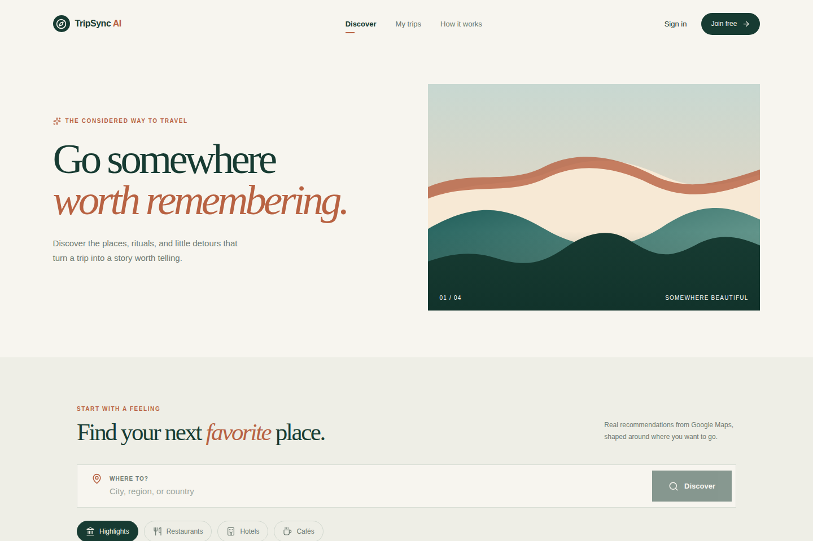
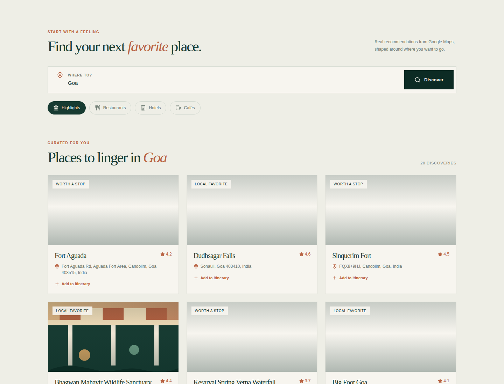
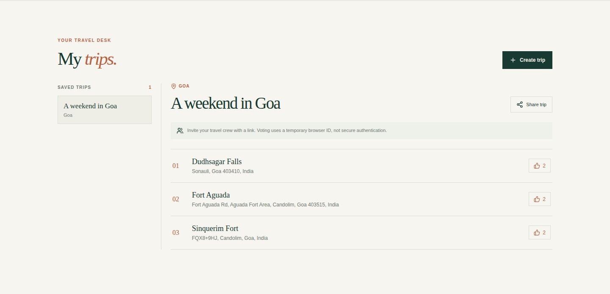
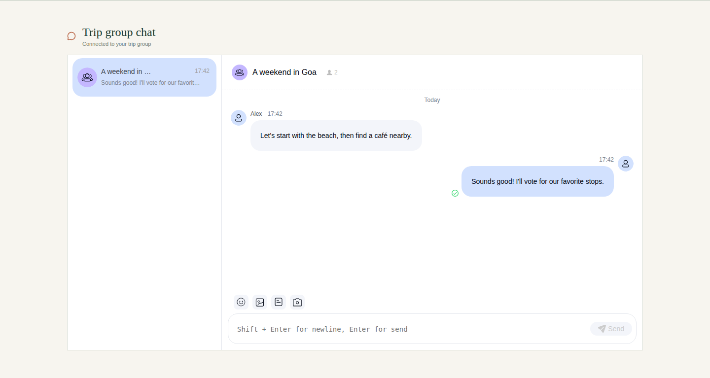

# TripSync AI

TripSync helps small travel groups turn real destination discoveries into a shared, voteable itinerary. The product combines live SerpApi place discovery, trip-scoped Rust WebSockets, deterministic smart ranking, persistent SQLite plans, authenticated collaboration, and Nexconn's official Group Chat UI integration.

## Live Demo

**[Open TripSync AI](https://beneficial-michelle-ministry-scratch.trycloudflare.com)**

The demo runs the complete Next.js frontend and Rust API, with authentication, persistent SQLite trips, live SerpApi discovery, real-time voting over WebSockets, smart itinerary planning, and Nexconn group chat. Live chat has been verified between two independent browser sessions, including replies and history after refresh.

This is a free, temporary Cloudflare Quick Tunnel. The Ubuntu laptop and tunnel must stay running; restarting the tunnel can change the URL. See [deployment instructions](DEPLOYMENT.md) and the [demo checklist](DEMO_CHECKLIST.md).

## Features

- Google Maps place discovery through SerpApi with an API-side cache.
- Shared trip links with explicit account sign-in and trip membership before edits.
- Argon2 password hashes, expiring server-side SQLite sessions, HttpOnly cookies, origin/CSRF checks, and rate-limited account endpoints.
- Trip-scoped Rust WebSockets for stop, vote, and applied-plan updates; reconnect sync events refresh state.
- Duplicate-safe votes use the authenticated user ID, not client-supplied identity.
- Smart recommendations use real SerpApi results and a documented deterministic score. Generated plans are saved as drafts, manually reorderable, and applied only after confirmation.
- Nexconn group chat is implemented against the official ChatUI and signed Platform APIs. Real provider operation requires an App Key and App Secret in the API environment; without them, chat clearly reports that it is unconfigured and does not simulate messages.
- Request IDs, structured request logs, `/health`, `/ready`, `/metrics`, and k6 scripts.

## Screenshots

Captured from the running public application using dedicated demo accounts and real provider integrations.

### Travel landing page



### Live destination discovery



### Shared trip and voting



### Nexconn group chat



## Local Setup

```bash
cp apps/api/.env.example apps/api/.env
cp apps/web/.env.example apps/web/.env.local
```

Set `SERPAPI_KEY` in `apps/api/.env` to enable real recommendations. For chat, set `NEXCONN_APP_KEY` and `NEXCONN_APP_SECRET` server-side; never put the secret in a `NEXT_PUBLIC_*` variable. Nexconn App Key values come from Console > App Key Management. `APP_ORIGIN` must exactly match the browser origin.

Start the API and web app in separate terminals:

```bash
cd apps/api && cargo run
cd apps/web && npm run dev
```

Open `http://localhost:3000`. SQLite migrations run automatically at API startup. Browser requests use same-origin `/api` URLs; Next rewrites them to `API_INTERNAL_URL` (default `http://localhost:8080` for local development).

## Architecture and Docs

- [ARCHITECTURE.md](ARCHITECTURE.md): components, trust boundaries, and data flow.
- [DEPLOYMENT.md](DEPLOYMENT.md): Docker, HTTPS/WSS, persistent SQLite, and free-tier limitations.
- [TESTING.md](TESTING.md): automated suites and two-browser verification steps.
- [DEMO_SCRIPT.md](DEMO_SCRIPT.md): three-minute product walkthrough.
- [PITCH.md](PITCH.md): problem, solution, provider value, and differentiation.
- [SUBMISSION_CHECKLIST.md](SUBMISSION_CHECKLIST.md): final readiness checklist.

The Rust API is in `apps/api`; the Next.js frontend is in `apps/web`. Keep SerpApi and Nexconn secrets in the API environment; never commit them or include them in screenshots.
